<picture><source media="(prefers-color-scheme: dark)" srcset="assets/dist/hero-entry-level-jobs-dark.svg"><source media="(prefers-color-scheme: light)" srcset="assets/dist/hero-entry-level-jobs-light.svg"></picture>

<a href="#open-jobs"><picture><source media="(prefers-color-scheme: dark)" srcset="assets/dist/btn-primary-dark.svg"><source media="(prefers-color-scheme: light)" srcset="assets/dist/btn-primary-light.svg"></picture></a>

<a href="https://chromewebstore.google.com/detail/gmdkffapbfeanfecgcodocfcefldjaho"><picture><source media="(prefers-color-scheme: dark)" srcset="assets/dist/btn-extension-dark.svg"><source media="(prefers-color-scheme: light)" srcset="assets/dist/btn-extension-light.svg"></picture></a>&nbsp;&nbsp;<a href="https://jobhacki.com/login-v2"><picture><source media="(prefers-color-scheme: dark)" srcset="assets/dist/btn-account-dark.svg"><source media="(prefers-color-scheme: light)" srcset="assets/dist/btn-account-light.svg"></picture></a>

Join the JobHacki Discord community to talk about jobs with other job seekers.

<a href="https://discord.gg/RApjXmgnwA">Ask questions about entry level jobs in #entry-level-jobs.</a>

**⭐ Star this repo to find the entry level jobs list again easily.**

<table><tr><td align="center" valign="top"><h3>26,614</h3>open entry-level jobs in this list (latest refresh)</td><td align="center" valign="top"><h3>150</h3>freshest rows shown below</td><td align="center" valign="top"><h3>2026-11-23</h3>newest posting date</td></tr></table>

Snapshot 2026-11-23 16:17 UTC

**Hi, I'm Sophia, JobHacki's AI assistant. Pick a list, inspect a role, and follow its employer link.**

Looking for your first job or starting your career? This list is a fresh slice of entry level jobs taken from employers' own hiring systems, last updated on Nov 23, 2026.

[Back to all 12 lists](https://github.com/Jobhacki/jobs)

 

<picture><source media="(prefers-color-scheme: dark)" srcset="assets/dist/divider-dark.svg"><source media="(prefers-color-scheme: light)" srcset="assets/dist/divider-light.svg"></picture>

## How to use this list

1. Scan the table for roles that match your skills and interests.
2. Check the posting date and read the employer's experience requirements.
3. Open the employer's apply link to review the role and apply.
4. If useful, try the Chrome extension, free account, or Discord as optional extras.
5. Report a dead link or suggest a starter role using [CONTRIBUTING.md](CONTRIBUTING.md) and issues.

## Open jobs

**26,614 open entry-level jobs seen in the latest refresh.** The table shows the freshest 150. **Last updated: 2026-11-23 16:17 UTC.** Apply links go to the employer's career page or hiring system.

<!-- JOBS_TABLE_START -->
| Role | Employer | Location | Pay | Posted | Apply |
|---|---|---|---|---|---|
| Plumbing Apprentice | hbglobal | Harrisburg, PA |  | 2026-11-23 | [Apply](https://hbglobal.wd108.myworkdayjobs.com/en-US/hbhs/job/Harrisburg-PA/Plumbing-Apprentice_JR100802) |
| PREMIER Financial Modeling & Analysis Internship | firstpremier | Sioux Falls, SD |  | 2026-11-23 | [Apply](https://firstpremier.wd503.myworkdayjobs.com/en-US/premier_careers/job/Sioux-Falls-SD/PREMIER-Financial-Modeling---Analysis-Internship_R-517-1) |
| Software Engineer, Winter 2027 (Co-op/Internship) -4 months | bmo | San Ramon, CA, USA |  | 2026-11-23 | [Apply](https://bmo.wd3.myworkdayjobs.com/en-US/privileged/job/San-Ramon-CA-USA/Software-Engineer--Winter-2027--Co-op-Internship---4-months_R260031974) |
| Newsroom Summer Internship Program 2027: Visual Journalists | washpost | DC-Washington-TWP Headquarters |  | 2026-11-23 | [Apply](https://washpost.wd5.myworkdayjobs.com/en-US/washingtonpostcareers/job/DC-Washington-TWP-Headquarters/Newsroom-Summer-Internship-Program-2027--Visual-Journalists_JR-90275901) |
| Purchasing Specialist, Entry | kodiakgas | TX - Calliham |  | 2026-11-23 | [Apply](https://kodiakgas.wd12.myworkdayjobs.com/en-US/kodiakgascareers/job/TX---Calliham/Purchasing-Specialist--Entry_JR3948) |
| Grain Leadership Trainee | cgb | 9 Locations |  | 2026-11-23 | [Apply](https://cgb.wd5.myworkdayjobs.com/en-US/cgb_careers/job/Hennepin-IL/Grain-Leadership-Trainee_R0007313) |
| Grain Leadership Trainee | cgb | 9 Locations |  | 2026-11-23 | [Apply](https://cgb.wd5.myworkdayjobs.com/en-US/cgb_careers/job/Cincinnati-OH/Grain-Leadership-Trainee_R0007315) |
| Grain Leadership Trainee | cgb | 9 Locations |  | 2026-11-23 | [Apply](https://cgb.wd5.myworkdayjobs.com/en-US/cgb_careers/job/Gladstone-IL/Grain-Leadership-Trainee_R0007314) |
| Reliability Engineering Intern | cartech | Tanner, AL |  | 2026-11-23 | [Apply](https://cartech.wd5.myworkdayjobs.com/en-US/ctcexternal/job/Tanner-AL/Reliability-Engineering-Intern_27045) |
| Emerging Talent Attraction Solutions Intern (Undergraduate - Summer) | centene | 4 Locations |  | 2026-11-23 | [Apply](https://centene.wd5.myworkdayjobs.com/en-US/centene_external/job/Remote-MO/Emerging-Talent-Attraction-Solutions-Intern--Undergraduate---Summer-_1654898) |
| Intern, AI & App Development - SAP | cbrands | 2 Locations |  | 2026-11-23 | [Apply](https://cbrands.wd5.myworkdayjobs.com/en-US/cbi_external_careers/job/Rochester-New-York/Intern--AI---App-Development---SAP_R-41697) |
| Apprentice Tech | ritehite | USA-WI-Madison |  | 2026-11-23 | [Apply](https://ritehite.wd12.myworkdayjobs.com/en-US/rhh/job/USA-WI-Madison/Apprentice-Tech_JR102757) |
| Operations Intern | endurance | Charlotte, North Carolina |  | 2026-11-23 | [Apply](https://endurance.wd103.myworkdayjobs.com/en-US/sompointernational/job/Charlotte-North-Carolina/Operations-Intern_R4697) |
| Cybersecurity Analyst Intern | cai | FL-CLIENT-STATE |  | 2026-11-23 | [Apply](https://cai.wd5.myworkdayjobs.com/en-US/computer_aid/job/FL-CLIENT-STATE/Cybersecurity-Analyst-Intern_R9021) |
| Summer 2027 Genome Engineering Intern | astrazeneca | Cambridge MA – 100 Binney Street |  | 2026-11-23 | [Apply](https://astrazeneca.wd3.myworkdayjobs.com/en-US/alexion/job/Cambridge-MA--100-Binney-Street/Summer-2027-Genome-Engineering-Intern_R-264902) |
| MANAGER TRAINEE | towerloan | Springfield MO |  | 2026-11-23 | [Apply](https://towerloan.wd12.myworkdayjobs.com/en-US/tower_loan_careers/job/Springfield-MO/MANAGER-TRAINEE_JR2440) |
| Internal Communications & Events 2027 Summer Internship (Full Time/Paid/12 week... | acehardware | IL - Oak Brook |  | 2026-11-23 | [Apply](https://acehardware.wd1.myworkdayjobs.com/en-US/external/job/IL---Oak-Brook/Internal-Communications---Events-2027-Summer-Internship--Full-Time-Paid-12-weeks-_REQ-35058) |
| Health Education Graduate Student Assistant (work study/ non-work study) | utaustin | UT MAIN CAMPUS |  | 2026-11-23 | [Apply](https://utaustin.wd1.myworkdayjobs.com/en-US/utstudent/job/UT-MAIN-CAMPUS/Health-Education-Graduate-Student-Assistant--work-study--non-work-study-_R_00050137) |
| Summer 2027 Intern: Automotive | assurant | 2 Locations |  | 2026-11-23 | [Apply](https://assurant.wd1.myworkdayjobs.com/en-US/assurant_careers/job/Georgia-Virtual/Summer-2027-Intern--Automotive_R-115833-1) |
| Lineman Intern | aep | Tulsa, OK |  | 2026-11-23 | [Apply](https://aep.wd1.myworkdayjobs.com/en-US/aepcareersite/job/Tulsa-OK/Lineman-Intern_R21098) |
| Student Intern | menasha | Orion, Michigan |  | 2026-11-23 | [Apply](https://menasha.wd12.myworkdayjobs.com/en-US/menashacorp/job/Orion-Michigan/Student-Intern_R16926) |
| Power Marketing Internship | acciona | Illinois |  | 2026-11-23 | [Apply](https://acciona.wd3.myworkdayjobs.com/en-US/acciona_employment_channel/job/Illinois/Power-Marketing-Internship_20104226) |
| Quality, Safety, Environmental, and Sustainability Internship | acciona | Illinois |  | 2026-11-23 | [Apply](https://acciona.wd3.myworkdayjobs.com/en-US/acciona_employment_channel/job/Illinois/Quality--Safety--Environmental--and-Sustainability-Internship_20104315) |
| Business Development Intern | acciona | Illinois |  | 2026-11-23 | [Apply](https://acciona.wd3.myworkdayjobs.com/en-US/acciona_employment_channel/job/Illinois/Business-Development-Intern_20104316) |
| Auto Glass Installation Technician Trainee | belron | Ironwood, MI |  | 2026-11-23 | [Apply](https://belron.wd3.myworkdayjobs.com/en-US/safelite_careers/job/Ironwood-MI/Auto-Glass-Installation-Technician-Trainee_JR77587) |
| Auto Glass Installation Technician Trainee | belron | ALTAMONTE SPRINGS, FL |  | 2026-11-23 | [Apply](https://belron.wd3.myworkdayjobs.com/en-US/safelite_careers/job/ALTAMONTE-SPRINGS-FL/Auto-Glass-Installation-Technician-Trainee_JR74649) |
| Auto Glass Installation Technician Trainee | belron | RHINELANDER, WI |  | 2026-11-23 | [Apply](https://belron.wd3.myworkdayjobs.com/en-US/safelite_careers/job/RHINELANDER-WI/Auto-Glass-Installation-Technician-Trainee_JR77588) |
| Clinical Pharmacy Intern - Inpatient Pharmacy | bmc | Boston |  | 2026-11-23 | [Apply](https://bmc.wd1.myworkdayjobs.com/en-US/bmc/job/Boston/Clinical-Pharmacy-Intern---Inpatient-Pharmacy_52024) |
| Neurodiagnostic Technologist Trainee - Physical Therapy - Lourdes Hospital - PRN | easyservice | Paducah, KY |  | 2026-11-23 | [Apply](https://easyservice.wd5.myworkdayjobs.com/en-US/mercyhealthcareers/job/Paducah-KY/Neurodiagnostic-Technologist-Trainee---Physical-Therapy---Lourdes-Hospital---PRN_R293458) |
| Meat Cutter Apprentice Part Time | bjswholesaleclub | North Dartmouth, MA #0023 |  | 2026-11-23 | [Apply](https://bjswholesaleclub.wd1.myworkdayjobs.com/en-US/bjscareers/job/North-Dartmouth-MA-0023/Meat-Cutter-Apprentice-Part-Time_R262998) |
| Dental Assistant - Entry Level | aspendental | Ankeny, Iowa |  | 2026-11-23 | [Apply](https://aspendental.wd1.myworkdayjobs.com/en-US/careers_aspen_dental/job/Ankeny-Iowa/Dental-Assistant---Entry-Level_R2026-014446) |
| Pharmacy Grad Intern (Hrly) - $25,000 Sign On Bonus (2027 Grad Sign On Program) | Walmart | (USA) VA NORFOLK 05488 WM SUPERCENTER |  | 2026-11-23 | [Apply](https://walmart.wd504.myworkdayjobs.com/en-US/WalmartExternal/job/USA-VA-NORFOLK-05488-WM-SUPERCENTER/Pharmacy-Grad-Intern--Hrly-----25-000-Sign-On-Bonus--2027-Grad-Sign-On-Program-_R-2714838) |
| Pharmacy Grad Intern (Hrly) - $40,000 Sign On Bonus (2027 Grad Sign On Program) | Walmart | Zachary, LA |  | 2026-11-23 | [Apply](https://walmart.wd504.myworkdayjobs.com/en-US/WalmartExternal/job/Zachary-LA/Pharmacy-Grad-Intern--Hrly-_R-2715316) |
| High School Intern, Clinical, Non Certified - Radiology | Sanford Health | SD, Rapid City |  | 2026-11-23 | [Apply](https://sanford.wd5.myworkdayjobs.com/en-US/SanfordHealth/job/SD-Rapid-City/High-School-Intern--Clinical--Non-Certified---Radiology_R-0282560) |
| SATAS Graduate Research Intern – Modeling and Simulation | Intel | US, Arizona, Phoenix |  | 2026-11-23 | [Apply](https://intel.wd1.myworkdayjobs.com/en-US/External/job/US-Arizona-Phoenix/SATAS-Graduate-Research-Intern---Modeling-and-Simulation_JR0287092) |
| Personal Systems Engineering Internship | HP | Spring, Texas, United States of America |  | 2026-11-23 | [Apply](https://hp.wd5.myworkdayjobs.com/en-US/ExternalCareerSite/job/Spring-Texas-United-States-of-America/Personal-Systems-Engineering-Internship_3171404-1) |
| Pharmacy Intern | CVS Health | FL - Jacksonville |  | 2026-11-23 | [Apply](https://cvshealth.wd1.myworkdayjobs.com/en-US/CVS_Health_Careers/job/FL---Jacksonville/Pharmacy-Intern_R1082498) |
| Pharmacy Intern | CVS Health | FL - Alachua |  | 2026-11-23 | [Apply](https://cvshealth.wd1.myworkdayjobs.com/en-US/CVS_Health_Careers/job/FL---Alachua/Pharmacy-Intern_R1022603) |
| Pharmacy Intern | CVS Health | FL - Lake Butler |  | 2026-11-23 | [Apply](https://cvshealth.wd1.myworkdayjobs.com/en-US/CVS_Health_Careers/job/FL---Lake-Butler/Pharmacy-Intern_R1029580) |
| 2027 University Graduate - Sales Strategy & Operations Manager | Adobe | San Jose |  | 2026-11-23 | [Apply](https://adobe.wd5.myworkdayjobs.com/en-US/external_experienced/job/San-Jose/XMLNAME-2027-University-Graduate---Sales-Strategy---Operations-Manager_R173463) |
| Intern - Research and Development - Molecular | Labcorp | Westborough MA |  | 2026-11-23 | [Apply](https://labcorp.wd1.myworkdayjobs.com/en-US/External/job/Westborough-MA/Intern---Research-and-Development---Molecular_2632163-1) |
| Sales Trainee | RedBull | Dallas, TX, US |  | 2026-11-23 | [Apply](https://jobs.smartrecruiters.com/RedBull/744000163255939) |
| Junior Network Engineer (M/W) (V.I.E Contract) | Lesaffre | Headland, AL, US |  | 2026-11-23 | [Apply](https://jobs.smartrecruiters.com/Lesaffre/744000163237050) |
| Entry-Level Civil Engineer | langanengineeringandenvironmentalservicesllc | Philadelphia, PA |  | 2026-11-23 | [Apply](https://job-boards.greenhouse.io/langanengineeringandenvironmentalservicesllc/jobs/4405021009) |
| Investment Strategy - Summer 2027 Intern | icapitalnetwork | New York, New York, United States |  | 2026-11-23 | [Apply](https://job-boards.greenhouse.io/icapitalnetwork/jobs/8958529002) |
| Evergreen Private Fund Solutions - Summer 2027 Intern | icapitalnetwork | New York, New York, United States |  | 2026-11-23 | [Apply](https://job-boards.greenhouse.io/icapitalnetwork/jobs/8938080002) |
| Supply Chain Intern | regent | North Kingstown, Rhode Island, USA |  | 2026-11-23 | [Apply](https://jobs.ashbyhq.com/REGENT/24eb1938-a13b-4933-ba71-9e03ef740ec1) |
| Software Engineer, Intern (Summer 2027) | benchling | San Francisco, CA |  | 2026-11-23 | [Apply](https://jobs.ashbyhq.com/benchling/96370d1b-d35e-446b-8e26-dce088860099) |
| Junior Sales Representative - South Baldwin | D.R. Horton | Spanish Fort, AL, US |  | 2026-11-23 | [Apply](https://drhorton.taleo.net/careersection/2/jobdetail.ftl?job=2605817&lang=en) |
| Junior Sales Representative - North Baldwin | D.R. Horton | Spanish Fort, AL, US |  | 2026-11-23 | [Apply](https://drhorton.taleo.net/careersection/2/jobdetail.ftl?job=2605819&lang=en) |
| Junior Sales Representative - Central Baldwin | D.R. Horton | Spanish Fort, AL, US |  | 2026-11-23 | [Apply](https://drhorton.taleo.net/careersection/2/jobdetail.ftl?job=2605818&lang=en) |
| Intern/Co-op - Manufacturing - Spring 2027 Opportunities | bakerhughes | US-LA-BROUSSARD-1046 ALLIER ROAD |  | 2026-11-23 | [Apply](https://bakerhughes.wd5.myworkdayjobs.com/en-US/bakerhughes/job/US-LA-BROUSSARD-1046-ALLIER-ROAD/Intern-Co-op---Manufacturing---Spring-2027-Opportunities_R169443) |
| RN Emergency Department New Grad Days | honorhealth |  |  | 2026-11-23 | [Apply](https://honorhealth.wd12.myworkdayjobs.com/en-US/honorhealth_careers/job/Deer-Valley---19829-N-27th-Ave-Phoenix-AZ-85027/RN-Emergency-Department-New-Grad-Days_JR12422) |
| Sales, Trading and Structuring Analyst Summer Internship Program 2028 New York | barclays | New York, 745 7th Avenue |  | 2026-11-23 | [Apply](https://barclays.wd3.myworkdayjobs.com/en-US/external_career_site_barclays/job/New-York-745-7th-Avenue/Sales--Trading-and-Structuring-Analyst-Summer-Internship-Program-2028-New-York_JR-0000139050) |
| Public Finance Analyst Summer Internship Program 2028 New York | barclays | New York, 745 7th Avenue |  | 2026-11-23 | [Apply](https://barclays.wd3.myworkdayjobs.com/en-US/external_career_site_barclays/job/New-York-745-7th-Avenue/Public-Finance-Analyst-Summer-Internship-Program-2028-New-York_JR-0000139048) |
| Markets Quantitative Analyst Summer Internship Program 2028 New York | barclays | New York, 745 7th Avenue |  | 2026-11-23 | [Apply](https://barclays.wd3.myworkdayjobs.com/en-US/external_career_site_barclays/job/New-York-745-7th-Avenue/Markets-Quantitative-Analyst-Summer-Internship-Program-2028-New-York_JR-0000139049) |
| Technologist Trainee | Labcorp | Shelton CT |  | 2026-11-23 | [Apply](https://labcorp.wd1.myworkdayjobs.com/en-US/External/job/Shelton-CT/Technologist-Trainee_2635530) |
| 2027 Internship, Spring - Academy Scout | RedBull | Morristown, NJ, US |  | 2026-11-23 | [Apply](https://jobs.smartrecruiters.com/RedBull/744000163139079) |
| 2027 Internship, Spring - RBII Team Analysis | RedBull | Morristown, NJ, US |  | 2026-11-23 | [Apply](https://jobs.smartrecruiters.com/RedBull/744000163139439) |
| Product Management Intern (Summer 2027) | first-resonance | Los Angeles |  | 2026-11-23 | [Apply](https://jobs.ashbyhq.com/first-resonance/56d901c8-ad63-4206-b5cb-b5691585b741) |
| Forward Deployed Engineering Intern (Summer 2027) | first-resonance | Los Angeles |  | 2026-11-23 | [Apply](https://jobs.ashbyhq.com/first-resonance/465193ff-26d7-41d1-8202-2b4ecb22ad0a) |
| Software Engineering Intern, Platform (Summer 2027) | first-resonance | Los Angeles |  | 2026-11-23 | [Apply](https://jobs.ashbyhq.com/first-resonance/0c88b508-432d-442d-aa5f-486e08aaf5a7) |
| Internship - Mechatronics Engineer | asml | Wilton, CT, USA |  | 2026-11-23 | [Apply](https://asml.wd3.myworkdayjobs.com/en-US/asmlext1/job/Wilton-CT-USA/Internship---Mechatronics-Engineer_J-00358112) |
| Internship - Finance Analyst | asml | Wilton, CT, USA |  | 2026-11-23 | [Apply](https://asml.wd3.myworkdayjobs.com/en-US/asmlext1/job/Wilton-CT-USA/Internship---Finance-Analyst_J-00358071) |
| Internship - Mechatronics Engineer | asml | Wilton, CT, USA |  | 2026-11-23 | [Apply](https://asml.wd3.myworkdayjobs.com/en-US/asmlext1/job/Wilton-CT-USA/Internship---Mechatronics-Engineer_J-00357865) |
| Pharmacy Technician Trainee | Munson Healthcare | Traverse City, Michigan, US |  | 2026-11-23 | [Apply](https://jobs.smartrecruiters.com/MunsonHealthcare1/3743990017024826) |
| 2027 R&D Summer Internship- Pittsburgh | Sherwin-Williams | Pittsburgh, PA, United States |  | 2026-11-22 | [Apply](https://ejhp.fa.us6.oraclecloud.com/hcmUI/CandidateExperience/en/sites/CX_2/job/2629849) |
| Nightlife/Daylife Apprentice Bartender/Marketing Model - 2027 Season | Wynn Resorts | Las Vegas, NV, US |  | 2026-11-22 | [Apply](https://jobs.smartrecruiters.com/WynnResorts/744000163104999) |
| Heavy Equipment Technician (Mechanic) Apprentice | equipmentsharecom | St. Louis, MO |  | 2026-11-22 | [Apply](https://www.equipmentshare.com/careers/openings/?gh_jid=8397114) |
| Business Development Internship | cellsignalingtechnology79 | DANVERS, MA |  | 2026-11-22 | [Apply](https://job-boards.greenhouse.io/cellsignalingtechnology79/jobs/4731461006) |
| Automation Internship | cellsignalingtechnology79 | DANVERS, MA |  | 2026-11-22 | [Apply](https://job-boards.greenhouse.io/cellsignalingtechnology79/jobs/4731465006) |
| IT Internship | cellsignalingtechnology79 | DANVERS, MA |  | 2026-11-22 | [Apply](https://job-boards.greenhouse.io/cellsignalingtechnology79/jobs/4731459006) |
| Work at Home Data Entry Agent - Part Time | usasurveyjob | Burbank, California |  | 2026-11-22 | [Apply](https://jobs.lever.co/usasurveyjob/ee4266f3-f7d2-4440-9351-b8e4b4c294a1) |
| Work at Home Data Entry Agent - Part Time | usasurveyjob | Oxnard, California |  | 2026-11-22 | [Apply](https://jobs.lever.co/usasurveyjob/e875c480-b39a-4596-892e-041aa8528e4d) |
| Work at Home Data Entry Agent - Part Time | usasurveyjob | Huntsville, Alabama |  | 2026-11-22 | [Apply](https://jobs.lever.co/usasurveyjob/90e5de64-1040-4e4b-98ee-4e74a72683be) |
| Coach/Ops Mgr Trainee | Walmart | (USA) TN COLLIERVILLE 00175 WM SUPERCENTER |  | 2026-11-22 | [Apply](https://walmart.wd504.myworkdayjobs.com/en-US/WalmartExternal/job/USA-TN-COLLIERVILLE-00175-WM-SUPERCENTER/Coach-Ops-Mgr-Trainee_R-2717784-1) |
| 3rd shift Entry Level Optical Manufacturing | National Vision | St. Cloud, MN, US |  | 2026-11-22 | [Apply](https://jobs.smartrecruiters.com/NationalVision1/744000163086449) |
| 2nd Shift Entry Level Optical Manufacturing | National Vision | St. Cloud, MN, US |  | 2026-11-22 | [Apply](https://jobs.smartrecruiters.com/NationalVision1/744000163086509) |
| Assistant Manager (01691) - 4201 Dr Martin Luther King Jr Blvd | Domino's | Kansas City, MO, US |  | 2026-11-22 | [Apply](https://jobs.smartrecruiters.com/Dominos/744000163032131) |
| Delivery Driver(05389) - 1098 Dr MLK Jr Expy | Domino's | Andalusia, AL, US |  | 2026-11-22 | [Apply](https://jobs.smartrecruiters.com/Dominos/744000163047884) |
| Software Engineer, New Grad | Secureframe | New York, NY |  | 2026-11-21 | [Apply](https://jobs.ashbyhq.com/secureframe/ab69f040-9b87-4420-9150-edc6e4f54cfb) |
| Firmware/Embedded Software Engineer Intern - Summer 2027 | nerostechnologies | Torrance, California, United States |  | 2026-11-21 | [Apply](https://job-boards.greenhouse.io/nerostechnologies/jobs/5278981007) |
| 2027 Ogilvy Creative Summer Internship | ogilvy | Chicago, United States |  | 2026-11-21 | [Apply](https://www.ogilvy.com/careers/4757364005?gh_jid=4757364005) |
| 2027 Ogilvy Creative Summer Internship | ogilvy | New York, New York |  | 2026-11-21 | [Apply](https://www.ogilvy.com/careers/4757353005?gh_jid=4757353005) |
| 2027 The Ogilvy Group General Summer Internship | ogilvy | Chicago, United States |  | 2026-11-21 | [Apply](https://www.ogilvy.com/careers/4757341005?gh_jid=4757341005) |
| Mechanical Engineer Intern - Summer 2027 | nerostechnologies | Torrance, California, United States |  | 2026-11-21 | [Apply](https://job-boards.greenhouse.io/nerostechnologies/jobs/4648209007) |
| Electrical Engineering Intern - Summer 2027 | nerostechnologies | Torrance, California, United States |  | 2026-11-21 | [Apply](https://job-boards.greenhouse.io/nerostechnologies/jobs/5273149007) |
| New Graduate Engineer, Electrical (Starfall) | SpaceX | Hawthorne, CA |  | 2026-11-21 | [Apply](https://boards.greenhouse.io/spacex/jobs/8957873002?gh_jid=8957873002) |
| Leadership Development Trainee | AlphabeInsightInc | San Antonio, TX, US |  | 2026-11-21 | [Apply](https://jobs.smartrecruiters.com/AlphabeInsightInc/744000162962449) |
| Strategic Operations Intern | clera | New York |  | 2026-11-21 | [Apply](https://jobs.ashbyhq.com/Clera/2698b76b-078f-4531-a6e8-2d15f0e2e963) |
| Founders Associate Intern | clera | San Francisco |  | 2026-11-21 | [Apply](https://jobs.ashbyhq.com/Clera/b4d66f3b-2471-4005-a1ab-1d3176d7f7a9) |
| Operations Intern | clera | Salt Lake City |  | 2026-11-21 | [Apply](https://jobs.ashbyhq.com/Clera/c9ae9435-2ca6-4222-a1de-7e20d44e974c) |
| COORDINATED ENTRY RESEARCH ANALYST | City of New York | New York, NY, US |  | 2026-11-21 | [Apply](https://jobs.smartrecruiters.com/CityOfNewYork/3743990017021786) |
| Public Health Assistant, Data Entry | City of New York | Long Island City, NY, US |  | 2026-11-21 | [Apply](https://jobs.smartrecruiters.com/CityOfNewYork/3743990017022116) |
| Data Entry Specialist - Coding Support | alpinephysicians | USA, Texas, Remote |  | 2026-11-21 | [Apply](https://alpinephysicians.wd1.myworkdayjobs.com/en-US/external/job/USA-Texas-Remote/Data-Entry-Specialist---Coding-Support_R0002340-1) |
| Quality Intern | regent | North Kingstown, Rhode Island, USA |  | 2026-11-21 | [Apply](https://jobs.ashbyhq.com/REGENT/068d624a-7ff2-4023-b98c-0de32a84a03a) |
| Program Management Intern | regent | North Kingstown, Rhode Island, USA |  | 2026-11-21 | [Apply](https://jobs.ashbyhq.com/REGENT/eb8397a4-ec2a-4287-bda1-6db4bbf821cf) |
| SI/PI Intern | Etched | San Jose |  | 2026-11-21 | [Apply](https://jobs.ashbyhq.com/Etched/45639738-0414-43e2-a5e7-b4acc928d62d) |
| Data Science Intern | advanceauto | Raleigh, NC |  | 2026-11-21 | [Apply](https://advanceauto.wd5.myworkdayjobs.com/en-US/advanceexternalcareers/job/Raleigh-NC/Data-Science-Intern_R-0620261-1) |
| Data Analyst Intern | bankeasy | 2 Locations |  | 2026-11-21 | [Apply](https://bankeasy.wd5.myworkdayjobs.com/en-US/bank-easy-job-openings/job/Brookings-SD-East/Data-Analyst-Intern_R-100864) |
| PREMIER Workforce Management Internship | firstpremier | Sioux Falls, SD |  | 2026-11-21 | [Apply](https://firstpremier.wd503.myworkdayjobs.com/en-US/premier_careers/job/Sioux-Falls-SD/PREMIER-Workforce-Management-Internship_R-537-1) |
| PREMIER Risk Services Internship | firstpremier | 4 Locations |  | 2026-11-21 | [Apply](https://firstpremier.wd503.myworkdayjobs.com/en-US/premier_careers/job/Sioux-Falls-SD/PREMIER-Risk-Services-Internship_R-548-1) |
| Caseworker Trainee 37.5 FT | lancastercountypa | Behavioral Health Developmental Services - 150 North Queen Street, La... |  | 2026-11-21 | [Apply](https://lancastercountypa.wd12.myworkdayjobs.com/en-US/lanco/job/Behavioral-Health-Developmental-Services---150-North-Queen-Street-Lancaster-PA/Caseworker-Trainee-375-FT_JR-2026-597-1) |
| Front-End Web Developer Co-Op | gorbel | USA, New York, Victor |  | 2026-11-21 | [Apply](https://gorbel.wd501.myworkdayjobs.com/en-US/gorbelcareers/job/USA-New-York-Victor/Front-End-Web-Developer-Co-Op_REQ-2026-2375-1) |
| Pursuits & Preconstruction Engineering Intern | amesconstruction | Burnsville, MN |  | 2026-11-21 | [Apply](https://amesconstruction.wd12.myworkdayjobs.com/en-US/ames/job/Burnsville-MN/Pursuits---Preconstruction-Engineering-Intern_JR2144) |
| Geotechnical Engineer – Entry Level – 2+ Years (Hybrid) | barr | 3 Locations |  | 2026-11-21 | [Apply](https://barr.wd1.myworkdayjobs.com/en-US/barrcareers/job/Salt-Lake-City-UT/Geotechnical-Engineer---Entry-Level---2--Years--Hybrid-_R-102441) |
| Pharmacy Undergraduate Summer Intern | centene | Remote-MO |  | 2026-11-21 | [Apply](https://centene.wd5.myworkdayjobs.com/en-US/centene_external/job/Remote-MO/Pharmacy-Undergraduate-Summer-Intern_1667799) |
| Supply Chain Process Intern (Summer 2027) | acehardware | CA - Visalia |  | 2026-11-21 | [Apply](https://acehardware.wd1.myworkdayjobs.com/en-US/external/job/CA---Visalia/Supply-Chain-Process-Intern--Summer-2027-_REQ-35205) |
| Route Trainee - (Wednesdays - Sundays) | pbv | St. Pauls, NC |  | 2026-11-21 | [Apply](https://pbv.wd503.myworkdayjobs.com/en-US/external/job/St-Pauls-NC/Route-Trainee----Wednesdays---Sundays-_R-2026-4876) |
| Oncology Discovery BioSciences Intern | bristolmyerssquibb | Cambridge Crossing - MA - US |  | 2026-11-21 | [Apply](https://bristolmyerssquibb.wd5.myworkdayjobs.com/en-US/bms/job/Cambridge-Crossing---MA---US/Oncology-Discovery-BioSciences-Intern_R1608776) |
| Oncology Research Co-op (Undergraduate or Graduate) | bristolmyerssquibb | Cambridge Crossing - MA - US |  | 2026-11-21 | [Apply](https://bristolmyerssquibb.wd5.myworkdayjobs.com/en-US/bms/job/Cambridge-Crossing---MA---US/Oncology-Research-Co-op--Undergraduate-or-Graduate-_R1608777) |
| Data Science Analyst II (Intern) – Untied States | cisco | San Jose, California, US |  | 2026-11-21 | [Apply](https://cisco.wd5.myworkdayjobs.com/en-US/cisco_careers/job/San-Jose-California-US/Data-Science-Analyst-II--Intern----Untied-States_2032691) |
| Technical Sales I (Intern) - United States | cisco | RTP, North Carolina, US |  | 2026-11-21 | [Apply](https://cisco.wd5.myworkdayjobs.com/en-US/cisco_careers/job/RTP-North-Carolina-US/Technical-Sales-I--Intern----United-States_2032666) |
| Field Sales I (Intern) - United States | cisco | RTP, North Carolina, US |  | 2026-11-21 | [Apply](https://cisco.wd5.myworkdayjobs.com/en-US/cisco_careers/job/RTP-North-Carolina-US/Field-Sales-I--Intern----United-States_2032668) |
| Embedded Software Engineer - Entry-Level | boeing | 2 Locations |  | 2026-11-21 | [Apply](https://boeing.wd1.myworkdayjobs.com/en-US/external_careers/job/USA---Hazelwood-MO/Embedded-Software-Engineer---Entry-Level_JR2026522089-1) |
| Systems Engineering Co-Op (Software) | valeo | Troy, MI |  | 2026-11-21 | [Apply](https://valeo.wd3.myworkdayjobs.com/en-US/valeo_jobs/job/Troy-MI/Systems-Engineering-Co-Op--Software-_REQ2026071241) |
| Dental Assistant - Entry Level | aspendental | Sandusky, Ohio |  | 2026-11-21 | [Apply](https://aspendental.wd1.myworkdayjobs.com/en-US/careers_aspen_dental/job/Sandusky-Ohio/Dental-Assistant---Entry-Level_R2026-014429-1) |
| Denture Lab Technician - Digital Trainee | aspendental | Stockton, California |  | 2026-11-21 | [Apply](https://aspendental.wd1.myworkdayjobs.com/en-US/careers_aspen_dental/job/Stockton-California/Denture-Lab-Technician---Digital-Trainee_R2026-014440) |
| RN New Grad - Aberdeen Medical Center - Full Time | Sanford Health | SD, Aberdeen |  | 2026-11-21 | [Apply](https://sanford.wd5.myworkdayjobs.com/en-US/SanfordHealth/job/SD-Aberdeen/RN-New-Grad---Aberdeen-Medical-Center---Full-Time_R-0282508) |
| Nursing Clinical Internship (NCI) / Clinic | Avera Health | Yankton, SD |  | 2026-11-21 | [Apply](https://avera.wd5.myworkdayjobs.com/en-US/avera-careers/job/Yankton-SD/Nursing-Clinical-Internship--NCI----Clinic_R-260031998) |
| Top Secret Jr Business Analyst/Tester | Bart & Associates | Washington, D.C., DC |  | 2026-11-20 | [Apply](https://recruiting.paylocity.com/Recruiting/Jobs/Details/4681404) |
| Apprentice Teacher Assistant | Community Partnership for Child Development | Colorado Springs, CO |  | 2026-11-20 | [Apply](https://recruiting.paylocity.com/Recruiting/Jobs/Details/4682449) |
| Intern Pre Licensed Therapist | Clarvida | Tehachapi, CA, United States |  | 2026-11-20 | [Apply](https://jobs.jobvite.com/pathways/job/ocU7Afwx) |
| Research Associate Intern | AArete | United States |  | 2026-11-20 | [Apply](https://jobs.jobvite.com/aarete/job/oo77AfwW) |
| Entry-Level Admin Support - Device Support Specialist | Midwest Mechanical | Lombard, IL |  | 2026-11-20 | [Apply](https://recruiting.paylocity.com/Recruiting/Jobs/Details/3820849) |
| Entry Level Traffic Engineer | SRF Consulting Group | Madison, WI |  | 2026-11-20 | [Apply](https://recruiting.paylocity.com/Recruiting/Jobs/Details/4683018) |
| Processing Plant Operator- IQF Trainee | Riverence Holdings LLC | BUHL, ID |  | 2026-11-20 | [Apply](https://recruiting.paylocity.com/Recruiting/Jobs/Details/4681607) |
| Junior Applications Developer | Monarch Investment and Management Group | Franktown, CO, United States |  | 2026-11-20 | [Apply](https://jobs.jobvite.com/monarchinvestment/job/otd8Afw8) |
| Jr. Multifamily Maintenance/Management Apprentice | Monarch Investment and Management Group | Maryland Heights, MO, United States |  | 2026-11-20 | [Apply](https://jobs.jobvite.com/monarchinvestment/job/orZ8AfwS) |
| Software Engineering (AI Building) Intern (Summer 2027) | Ralliant | Beaverton, OR, United States |  | 2026-11-20 | [Apply](https://ibwujb.fa.ocs.oraclecloud.com/hcmUI/CandidateExperience/en/sites/CX_1001/job/11324) |
| Software Design Engineer Intern (Summer 2027) | Ralliant | Beaverton, OR, United States |  | 2026-11-20 | [Apply](https://ibwujb.fa.ocs.oraclecloud.com/hcmUI/CandidateExperience/en/sites/CX_1001/job/11154) |
| Process Engineer Co-Op | Howmet Aerospace | LaPorte, IN, United States |  | 2026-11-20 | [Apply](https://fa-exty-saasfaprod1.fa.ocs.oraclecloud.com/hcmUI/CandidateExperience/en/sites/CX_1/job/120667) |
| Continuous Improvement Intern Winter 2027 | Howmet Aerospace | Rochester, NY, United States |  | 2026-11-20 | [Apply](https://fa-exty-saasfaprod1.fa.ocs.oraclecloud.com/hcmUI/CandidateExperience/en/sites/CX_1/job/120590) |
| Summer 2027 EHS Intern | Howmet Aerospace | Cleveland, OH, United States |  | 2026-11-20 | [Apply](https://fa-exty-saasfaprod1.fa.ocs.oraclecloud.com/hcmUI/CandidateExperience/en/sites/CX_1/job/119770) |
| Network Operations Co-Op | Boston Properties | Boston, MA, United States |  | 2026-11-20 | [Apply](https://edxn.fa.us2.oraclecloud.com/hcmUI/CandidateExperience/en/sites/CX_5001/job/26190) |
| Field Service Engineer Apprentice | Block Imaging Parts & Service, LLC | Detroit, MI |  | 2026-11-20 | [Apply](https://recruiting.paylocity.com/Recruiting/Jobs/Details/4683775) |
| Brand Launch & Preschool Expansion Intern | HEALTHY KIDS PROGRAMS | Poughkeepsie, NY |  | 2026-11-20 | [Apply](https://recruiting.paylocity.com/Recruiting/Jobs/Details/4683519) |
| Winter 2027 TechTown Detroit Internship Program | TechTown Detroit | Detroit, MI |  | 2026-11-20 | [Apply](https://recruiting.paylocity.com/Recruiting/Jobs/Details/4682457) |
| Junior Storm Community Clinic Coach | Force 10 Hoops, LLC | Hybrid - King County, WA |  | 2026-11-20 | [Apply](https://recruiting.paylocity.com/Recruiting/Jobs/Details/4682527) |
| Intern | Hulcher Services, Inc. | DENTON, TX |  | 2026-11-20 | [Apply](https://recruiting.paylocity.com/Recruiting/Jobs/Details/4681769) |
| Technical Marketing Engineering Intern, Digital Biology and Scientific Computin... | NVIDIA | US, CA, Santa Clara |  | 2026-11-20 | [Apply](https://nvidia.wd5.myworkdayjobs.com/en-US/NVIDIAExternalCareerSite/job/US-CA-Santa-Clara/Technical-Marketing-Engineering-Intern--Digital-Biology-and-Scientific-Computing---Summer-2027_JR2029793) |
| Accounting AI Solution Engineer Intern - Summer 2027 | NVIDIA | US, CA, Santa Clara |  | 2026-11-20 | [Apply](https://nvidia.wd5.myworkdayjobs.com/en-US/NVIDIAExternalCareerSite/job/US-CA-Santa-Clara/Accounting-AI-Solution-Engineer-Intern---Summer-2027_JR2029155-1) |
| Retail Store Management Trainee - 2134 | Cash America Pawn | Arlington, TX, United States |  | 2026-11-20 | [Apply](https://jobs.jobvite.com/firstcash-holdings-inc/job/oUl7AfwG) |
| Visiting Jr. Researcher, Radiation Oncology | UT Southwestern Medical Center | Dallas, TX, US |  | 2026-11-20 | [Apply](https://utsw.taleo.net/careersection/2/jobdetail.ftl?job=988060&lang=en) |
| Spring 2027 - AI & Data Analytics Intern | onsemi | Scottsdale, AZ, United States |  | 2026-11-20 | [Apply](https://hctz.fa.us2.oraclecloud.com/hcmUI/CandidateExperience/en/sites/CX_1001/job/2507010) |
| Intern - Year Round (Systems Support) | Navy Federal | Pensacola, FL, United States |  | 2026-11-20 | [Apply](https://fa-etbx-saasfaprod1.fa.ocs.oraclecloud.com/hcmUI/CandidateExperience/en/sites/nfcu/job/33339) |
| Civil Engineering Intern- Summer 2027 | WSP | Herndon, VA, United States |  | 2026-11-20 | [Apply](https://emit.fa.ca3.oraclecloud.com/hcmUI/CandidateExperience/en/sites/CX_2001/job/99827) |
| Mechanical Engineering Intern - Summer 2027 | WSP | Greenville, SC, United States |  | 2026-11-20 | [Apply](https://emit.fa.ca3.oraclecloud.com/hcmUI/CandidateExperience/en/sites/CX_2001/job/99351) |
| Graduate Electrical Engineer | GHD | MIAMI, FL, United States |  | 2026-11-20 | [Apply](https://ejov.fa.ca2.oraclecloud.com/hcmUI/CandidateExperience/en/sites/CX/job/29510) |
| Operations Manager Trainee Floorcovering | Sherwin-Williams | Richmond, VA, United States |  | 2026-11-20 | [Apply](https://ejhp.fa.us6.oraclecloud.com/hcmUI/CandidateExperience/en/sites/CX_2/job/2629807) |
<!-- JOBS_TABLE_END -->

<b>How this list is built</b>

- Source: the JobHacki job directory. This repo only includes jobs from public company hiring systems (ATS). It leaves out hidden job boards, such as static "general apply" pages on company websites, Notion boards and others.
- Scope: United States listings plus remote roles with no country set (the same default as jobhacki.com).
- Order: newest posting date first, at most 3 rows per employer so one company cannot fill the list. Posting dates are day-level, as published by the employer system.
- Pay is shown only when the employer system publishes it.
- Employer names are plain text. Apply links open the employer's own posting; links that carry tracking or session parameters are left out.

## More lists

[All job lists (master)](https://github.com/Jobhacki/jobs)

<table><tr><td align="center" width="33%"><a href="https://github.com/Jobhacki/internships-new-grad-2027"><picture><source media="(prefers-color-scheme: dark)" srcset="assets/dist/card-internships-new-grad-2027-dark.svg"><source media="(prefers-color-scheme: light)" srcset="assets/dist/card-internships-new-grad-2027-light.svg"></picture></a></td><td align="center" width="33%"><a href="https://github.com/Jobhacki/customer-service-jobs"><picture><source media="(prefers-color-scheme: dark)" srcset="assets/dist/card-customer-service-jobs-dark.svg"><source media="(prefers-color-scheme: light)" srcset="assets/dist/card-customer-service-jobs-light.svg"></picture></a></td><td align="center" width="33%"><a href="https://github.com/Jobhacki/remote-jobs"><picture><source media="(prefers-color-scheme: dark)" srcset="assets/dist/card-remote-jobs-dark.svg"><source media="(prefers-color-scheme: light)" srcset="assets/dist/card-remote-jobs-light.svg"></picture></a></td></tr></table>

## Explore JobHacki

<picture><source media="(prefers-color-scheme: dark)" srcset="assets/dist/explore-dark.svg"><source media="(prefers-color-scheme: light)" srcset="assets/dist/explore-light.svg"></picture>

Install the free JobHacki Chrome extension and sign in with a free JobHacki account to browse all 1.4M+ listings. Explore the full JobHacki directory whenever you're ready.

---

Source: JobHacki job directory, public employer hiring systems. © 2026 JobHacki. All rights reserved. Listings belong to their employers. See <a href="LICENSE">LICENSE</a>.

<a href="https://github.com/Jobhacki/jobs">All job lists</a> | <a href="CONTRIBUTING.md">Suggest a job or report a dead link</a> | <a href="https://jobhacki.com">jobhacki.com</a>
