<picture><source media="(prefers-color-scheme: dark)" srcset="assets/dist/hero-entry-level-jobs-dark.svg"><source media="(prefers-color-scheme: light)" srcset="assets/dist/hero-entry-level-jobs-light.svg"></picture>

<a href="#open-jobs"><picture><source media="(prefers-color-scheme: dark)" srcset="assets/dist/btn-primary-dark.svg"><source media="(prefers-color-scheme: light)" srcset="assets/dist/btn-primary-light.svg"></picture></a>

<a href="https://chromewebstore.google.com/detail/gmdkffapbfeanfecgcodocfcefldjaho"><picture><source media="(prefers-color-scheme: dark)" srcset="assets/dist/btn-extension-dark.svg"><source media="(prefers-color-scheme: light)" srcset="assets/dist/btn-extension-light.svg"></picture></a>&nbsp;&nbsp;<a href="https://jobhacki.com/login-v2"><picture><source media="(prefers-color-scheme: dark)" srcset="assets/dist/btn-account-dark.svg"><source media="(prefers-color-scheme: light)" srcset="assets/dist/btn-account-light.svg"></picture></a>

Join the JobHacki Discord community to talk about jobs with other job seekers.

<a href="https://discord.gg/RApjXmgnwA">Ask questions about entry level jobs in #entry-level-jobs.</a>

**⭐ Star this repo to find the entry level jobs list again easily.**

<table><tr><td align="center" valign="top"><h3>26,180</h3>open entry-level jobs in this list (latest refresh)</td><td align="center" valign="top"><h3>150</h3>freshest rows shown below</td><td align="center" valign="top"><h3>2026-11-20</h3>newest posting date</td></tr></table>

Snapshot 2026-11-20 20:17 UTC

**Hi, I'm Sophia, JobHacki's AI assistant. Pick a list, inspect a role, and follow its employer link.**

Looking for your first job or starting your career? This list is a fresh slice of entry level jobs taken from employers' own hiring systems, last updated on Nov 20, 2026.

[Back to all 12 lists](https://github.com/Jobhacki/jobs)

 

<picture><source media="(prefers-color-scheme: dark)" srcset="assets/dist/divider-dark.svg"><source media="(prefers-color-scheme: light)" srcset="assets/dist/divider-light.svg"></picture>

## How to use this list

1. Scan the table for roles that match your skills and interests.
2. Check the posting date and read the employer's experience requirements.
3. Open the employer's apply link to review the role and apply.
4. If useful, try the Chrome extension, free account, or Discord as optional extras.
5. Report a dead link or suggest a starter role using [CONTRIBUTING.md](CONTRIBUTING.md) and issues.

## Open jobs

**26,180 open entry-level jobs seen in the latest refresh.** The table shows the freshest 150. **Last updated: 2026-11-20 20:17 UTC.** Apply links go to the employer's career page or hiring system.

<!-- JOBS_TABLE_START -->
| Role | Employer | Location | Pay | Posted | Apply |
|---|---|---|---|---|---|
| Engineering Co-Op | SCHWING | St. Paul, MN, US |  | 2026-11-20 | [Apply](https://workforcenow.adp.com/mascsr/default/mdf/recruitment/recruitment.html?cid=d6d09230-0c51-4871-9ee2-2f90dc30e302&ccId=19000101_000001&jobId=963069&lang=en_US&source=CC2) |
| 2027 Summer Civil Engineering Intern | BKF | Sacramento, California, US |  | 2026-11-20 | [Apply](https://apply.workable.com/j/44D0B5F034) |
| 2027 Summer Civil Engineering Intern | BKF | Costa Mesa, California, US |  | 2026-11-20 | [Apply](https://apply.workable.com/j/C1D9A52F42) |
| Promotional Pricing Intern | advanceauto | Raleigh, NC |  | 2026-11-20 | [Apply](https://advanceauto.wd5.myworkdayjobs.com/en-US/advanceexternalcareers/job/Raleigh-NC/Promotional-Pricing-Intern_R-0620213) |
| General Accounting Intern | advanceauto | Raleigh, NC |  | 2026-11-20 | [Apply](https://advanceauto.wd5.myworkdayjobs.com/en-US/advanceexternalcareers/job/Raleigh-NC/General-Accounting-Intern_R-0620215) |
| Store Operations Finance Intern | advanceauto | Raleigh, NC |  | 2026-11-20 | [Apply](https://advanceauto.wd5.myworkdayjobs.com/en-US/advanceexternalcareers/job/Raleigh-NC/Store-Operations-Finance-Intern_R-0620225) |
| Life Sciences Technical Sales Internship - Cellular and Molecular Research | agilent | 2 Locations |  | 2026-11-20 | [Apply](https://agilent.wd5.myworkdayjobs.com/en-US/agilent_student_careers/job/US-VT-Remote-Location/Life-Sciences-Technical-Sales-Internship---Cellular-and-Molecular-Research_4040571) |
| 2027 Havner Curatorial Summer Intern | awe | Bentonville, AR |  | 2026-11-20 | [Apply](https://awe.wd1.myworkdayjobs.com/en-US/art_and_wellness/job/Bentonville-AR/XMLNAME-2027-Havner-Curatorial-Summer-Intern_JR2664) |
| Credit Analyst Internship - Chicago, IL (Summer 2027) | bmo | Chicago, IL, USA |  | 2026-11-20 | [Apply](https://bmo.wd3.myworkdayjobs.com/en-US/privileged/job/Chicago-IL-USA/Credit-Analyst-Internship---Chicago--IL--Summer-2027-_R260030161) |
| Plant Supervisor Trainee | agp | Sergeant Bluff, IA - Refinery |  | 2026-11-20 | [Apply](https://agp.wd12.myworkdayjobs.com/en-US/agp_careers/job/Sergeant-Bluff-IA---Refinery/Plant-Supervisor-Trainee_R-100565) |
| Student Marketing Intern, University Bookstore (Student Wage) | uva | Charlottesville, VA |  | 2026-11-20 | [Apply](https://uva.wd1.myworkdayjobs.com/en-US/uvastudentjobs/job/Charlottesville-VA/Student-Marketing-Intern--University-Bookstore--Student-Wage-_R0089339) |
| Intern, APN | mhctn | MHC Nashville, TN |  | 2026-11-20 | [Apply](https://mhctn.wd12.myworkdayjobs.com/en-US/mhc_careers/job/MHC-Nashville-TN/Intern--APN_JR102446) |
| Engineer Intern | structural | Columbia, MD |  | 2026-11-20 | [Apply](https://structural.wd12.myworkdayjobs.com/en-US/structuraltechnologiescareers/job/Columbia-MD/Engineer-Intern_JR-6875-1) |
| Junior Trader | advisorgroup | 5 Locations |  | 2026-11-20 | [Apply](https://advisorgroup.wd1.myworkdayjobs.com/en-US/advisor_career_site/job/Atlanta-GA/Junior-Trader_R0005380) |
| Civil Designer – Entry Level (Hybrid) | barr | 4 Locations |  | 2026-11-20 | [Apply](https://barr.wd1.myworkdayjobs.com/en-US/barrcareers/job/Minneapolis-MN/Civil-Designer---Entry-Level--Hybrid-_R-102436-1) |
| Business Technical Analyst Undergraduate Summer Intern | centene | Remote-MO |  | 2026-11-20 | [Apply](https://centene.wd5.myworkdayjobs.com/en-US/centene_external/job/Remote-MO/Business-Technical-Analyst-Undergraduate-Summer-Intern_1667760) |
| Civil Graduate | papedawson | 3 Locations |  | 2026-11-20 | [Apply](https://papedawson.wd12.myworkdayjobs.com/en-US/pde/job/Orlando-FL/Civil-Graduate_JR101873) |
| Civil Graduate | papedawson | 3 Locations |  | 2026-11-20 | [Apply](https://papedawson.wd12.myworkdayjobs.com/en-US/pde/job/Orlando-FL/Civil-Graduate_JR101874) |
| Intern - Data Governance | wgu | Salt Lake City, UT |  | 2026-11-20 | [Apply](https://wgu.wd5.myworkdayjobs.com/en-US/external/job/Salt-Lake-City-UT/Intern---Technical-Writing_JR-026370) |
| Intern - Technical | wgu | Salt Lake City, UT |  | 2026-11-20 | [Apply](https://wgu.wd5.myworkdayjobs.com/en-US/external/job/Salt-Lake-City-UT/Intern---Technical_JR-026525) |
| Legacy Plumbing - Plumbing Apprentice | acehardware | TX - Little Elm |  | 2026-11-20 | [Apply](https://acehardware.wd1.myworkdayjobs.com/en-US/external/job/TX---Little-Elm/Legacy-Plumbing---Plumbing-Apprentice_REQ-35156-1) |
| Graduate Assistant, Outreach | utaustin | UT MAIN CAMPUS |  | 2026-11-20 | [Apply](https://utaustin.wd1.myworkdayjobs.com/en-US/utstudent/job/UT-MAIN-CAMPUS/Graduate-Assistant--Outreach_R_00050105) |
| Tool Room Trainee | giorgiglobal | Muncie, Indiana |  | 2026-11-20 | [Apply](https://giorgiglobal.wd3.myworkdayjobs.com/en-US/canpack/job/Muncie-Indiana/Tool-Room-Trainee_R4327) |
| Army Instructor Jr ROTC | boystown | Omaha, NE |  | 2026-11-20 | [Apply](https://boystown.wd1.myworkdayjobs.com/en-US/boystowncareers/job/Omaha-NE/Army-Instructor-Jr-ROTC_REQ-2026-9742-1) |
| Delivery Driver Trainee DOT | pbv | 390 Business Park Drive Winston-Salem, NC |  | 2026-11-20 | [Apply](https://pbv.wd503.myworkdayjobs.com/en-US/external/job/390-Business-Park-Drive-Winston-Salem-NC/Delivery-Driver-Trainee-DOT_R-2026-4887) |
| Delivery Driver Trainee DOT | pbv | 390 Business Park Drive Winston-Salem, NC |  | 2026-11-20 | [Apply](https://pbv.wd503.myworkdayjobs.com/en-US/external/job/390-Business-Park-Drive-Winston-Salem-NC/Delivery-Driver-Trainee-DOT_R-2026-4888) |
| CDL Delivery Driver Trainee | pbv | Elizabeth City, NC |  | 2026-11-20 | [Apply](https://pbv.wd503.myworkdayjobs.com/en-US/external/job/Elizabeth-City-NC/CDL-Delivery-Driver-Trainee_R-2026-4658) |
| Kinship Child and Family Services Specialist/Trainee | son | Omaha, NE |  | 2026-11-20 | [Apply](https://son.wd108.myworkdayjobs.com/en-US/nebraskastatecareers/job/Omaha-NE/Kinship-Child-and-Family-Services-Specialist-Trainee_JR2026-00030679) |
| 2027 Software Systems Engineer and Acquisition Grad Intern | aero | 2 Locations |  | 2026-11-20 | [Apply](https://aero.wd5.myworkdayjobs.com/en-US/external/job/El-Segundo-CA/XMLNAME-2027-Software-Systems-Engineer-and-Acquisition-Grad-Intern_R017175) |
| 2027 Agile Space Systems Undergraduate Intern | aero | Albuquerque, NM |  | 2026-11-20 | [Apply](https://aero.wd5.myworkdayjobs.com/en-US/external/job/Albuquerque-NM/XMLNAME-2027-Agile-Space-Systems-Undergraduate-Intern_R017286) |
| 2027 Electronic Components Lab Undergrad Intern | aero | El Segundo, CA |  | 2026-11-20 | [Apply](https://aero.wd5.myworkdayjobs.com/en-US/external/job/El-Segundo-CA/XMLNAME-2027-Electronic-Components-Lab-Undergrad-Intern_R017285) |
| Internship - Learning Operations & Continuous Improvement Intern | asml | Chandler, AZ, USA |  | 2026-11-20 | [Apply](https://asml.wd3.myworkdayjobs.com/en-US/asmlext1/job/Chandler-AZ-USA/Internship---Learning-Operations---Continuous-Improvement-Intern_J-00357560) |
| Internship - Contract Management and AI | asml | San Diego, CA, USA |  | 2026-11-20 | [Apply](https://asml.wd3.myworkdayjobs.com/en-US/asmlext1/job/San-Diego-CA-USA/Internship---Contract-Management-and-AI_J-00357971) |
| Auto Glass Installation Technician Trainee | belron | YORK, PA |  | 2026-11-20 | [Apply](https://belron.wd3.myworkdayjobs.com/en-US/safelite_careers/job/YORK-PA/Auto-Glass-Installation-Technician-Trainee_JR77419) |
| Auto Glass Installation Technician Trainee | belron | READING, PA |  | 2026-11-20 | [Apply](https://belron.wd3.myworkdayjobs.com/en-US/safelite_careers/job/READING-PA/Auto-Glass-Installation-Technician-Trainee_JR77420) |
| Auto Glass Installation Technician Trainee | belron | CHARLOTTE, NC |  | 2026-11-20 | [Apply](https://belron.wd3.myworkdayjobs.com/en-US/safelite_careers/job/CHARLOTTE-NC/Auto-Glass-Installation-Technician-Trainee_JR77396) |
| Registered Nurse RN New Grad ICU | bannerhealth | BUMC South Tucson (2800 E Ajo Way) |  | 2026-11-20 | [Apply](https://bannerhealth.wd108.myworkdayjobs.com/en-US/careers/job/BUMC-South-Tucson-2800-E-Ajo-Way/Registered-Nurse-RN-New-Grad-ICU_R4461333-1) |
| General Finance Intern - Summer | carrier | 2 Locations |  | 2026-11-20 | [Apply](https://carrier.wd5.myworkdayjobs.com/en-US/jobs/job/CAF77-CCS---CIB-13995-Pasteur-Boulevard-Palm-Beach-Gardens-FL-33418-USA/General-Finance-Intern---Summer_30218055-2) |
| Digital Technology Intern - Summer | carrier | 2 Locations |  | 2026-11-20 | [Apply](https://carrier.wd5.myworkdayjobs.com/en-US/jobs/job/CAF77-CCS---CIB-13995-Pasteur-Boulevard-Palm-Beach-Gardens-FL-33418-USA/Digital-Technology-Intern---Summer_30222631) |
| Entry-Level Software Engineer–Developer | boeing | USA - Richardson, TX |  | 2026-11-20 | [Apply](https://boeing.wd1.myworkdayjobs.com/en-US/external_careers/job/USA---Richardson-TX/Entry-Level-Software-Engineer-Developer_JR2026523382-1) |
| Entry-Level Software Engineer–Test & Verification | boeing | USA - Tinker AFB, OK |  | 2026-11-20 | [Apply](https://boeing.wd1.myworkdayjobs.com/en-US/external_careers/job/USA---Tinker-AFB-OK/Entry-Level-Software-Engineer-Test---Verification_JR2026523081) |
| Dental Assistant - Entry Level | aspendental | Janesville, Wisconsin |  | 2026-11-20 | [Apply](https://aspendental.wd1.myworkdayjobs.com/en-US/careers_aspen_dental/job/Janesville-Wisconsin/Dental-Assistant---Entry-Level_R2026-014425) |
| Summer 2027 Supply Chain Buyer Intern- Bachelor's (Santa Clara, CA) | amat | Santa Clara,CA |  | 2026-11-20 | [Apply](https://amat.wd1.myworkdayjobs.com/en-US/external/job/Santa-ClaraCA/Summer-2027-Supply-Chain-Buyer-Intern--Bachelor-s--Santa-Clara--CA-_R2627066) |
| Billing Analyst, Junior | bah | 2 Locations |  | 2026-11-20 | [Apply](https://bah.wd1.myworkdayjobs.com/en-US/bah_jobs/job/McLean-VA/Billing-Analyst--Junior_R0251354) |
| Coach/Ops Mgr Trainee | Walmart | Sparta, TN |  | 2026-11-20 | [Apply](https://walmart.wd504.myworkdayjobs.com/en-US/WalmartExternal/job/Sparta-TN/Coach-Ops-Mgr-Trainee_R-2716995) |
| Pharmacy Grad Intern (Hrly) | Walmart | (USA) KY PIKEVILLE 01505 WM SUPERCENTER |  | 2026-11-20 | [Apply](https://walmart.wd504.myworkdayjobs.com/en-US/WalmartExternal/job/USA-KY-PIKEVILLE-01505-WM-SUPERCENTER/Pharmacy-Grad-Intern--Hrly-_R-2714737-1) |
| Pharmacy Grad Intern (Hrly) | Walmart | (USA) KY HAZARD 01247 WM SUPERCENTER |  | 2026-11-20 | [Apply](https://walmart.wd504.myworkdayjobs.com/en-US/WalmartExternal/job/USA-KY-HAZARD-01247-WM-SUPERCENTER/Pharmacy-Grad-Intern--Hrly-_R-2714706-1) |
| Summer 2027 Intern - Field Marketing, Missionforce | Salesforce | Virginia - Mclean |  | 2026-11-20 | [Apply](https://salesforce.wd12.myworkdayjobs.com/en-US/External_Career_Site/job/Virginia---Mclean/Summer-2027-Intern---Field-Marketing--Missionforce_JR369144-1) |
| Summer 2027 Intern - Product Marketing, Missionforce | Salesforce | California - San Francisco |  | 2026-11-20 | [Apply](https://salesforce.wd12.myworkdayjobs.com/en-US/External_Career_Site/job/California---San-Francisco/Summer-2027-Intern---Product-Marketing--Missionforce_JR369152-1) |
| Operation Manager Intern (Starting Summer 2027) Last Mile Distribution Center -... | Target | 2700 Winter St NE, Minneapolis,MN 55413-2945 |  | 2026-11-20 | [Apply](https://target.wd5.myworkdayjobs.com/en-US/targetcareers/job/2700-Winter-St-NE-MinneapolisMN-55413-2945/Operation-Manager-Intern--Starting-Summer-2027--Last-Mile-Distribution-Center---Minneapolis--MN_R0000450437) |
| Operation Manager Intern (Starting Summer 2027) Regional Distribution Center -... | Target | 25 N 75th Ave, Phoenix,AZ 85043-2109 |  | 2026-11-20 | [Apply](https://target.wd5.myworkdayjobs.com/en-US/targetcareers/job/25-N-75th-Ave-PhoenixAZ-85043-2109/Operation-Manager-Intern--Starting-Summer-2027--Regional-Distribution-Center---Phoenix--AZ_R0000450404) |
| Signal Integrity Engineering Intern | Intel | US, Arizona, Phoenix |  | 2026-11-20 | [Apply](https://intel.wd1.myworkdayjobs.com/en-US/External/job/US-Arizona-Phoenix/Signal-Integrity-Engineering-Intern_JR0289449) |
| Pharmacy Intern | CVS Health | IL - Chicago |  | 2026-11-20 | [Apply](https://cvshealth.wd1.myworkdayjobs.com/en-US/CVS_Health_Careers/job/IL---Chicago/Pharmacy-Intern_R1028217) |
| Pharmacy Intern - Grad | CVS Health | MA - Malden |  | 2026-11-20 | [Apply](https://cvshealth.wd1.myworkdayjobs.com/en-US/CVS_Health_Careers/job/MA---Malden/Pharmacy-Intern---Grad_R1111355) |
| Technologist Trainee | Labcorp | Spokane WA |  | 2026-11-20 | [Apply](https://labcorp.wd1.myworkdayjobs.com/en-US/External/job/Spokane-WA/Technologist-Trainee_2641277) |
| Work From Home - Benefits Team Supervisor Trainee | Aogarciaagency | Martinsburg, West Virginia |  | 2026-11-20 | [Apply](https://jobs.lever.co/aogarciaagency/f86062c2-2ea7-4cf4-a03f-0e53fab1afdc) |
| Work From Home - Benefits Team Supervisor Trainee | Aogarciaagency | St. Louis, Missouri |  | 2026-11-20 | [Apply](https://jobs.lever.co/aogarciaagency/615f344e-7915-4fb6-8524-914457a187bb) |
| Work From Home - Benefits Team Supervisor Trainee | Aogarciaagency | Prattville, Alabama |  | 2026-11-20 | [Apply](https://jobs.lever.co/aogarciaagency/60552932-2bf2-49a1-a406-01fa9edc5a4e) |
| Design Intern | reekon-tools | Boston, MA |  | 2026-11-20 | [Apply](https://jobs.lever.co/reekon-tools/0c5b8ec8-0ee0-41aa-84e1-8749d8c7e117) |
| Plant Operator Trainee | VeoliaEnvironnementSA | Wantagh, NY, US |  | 2026-11-20 | [Apply](https://jobs.smartrecruiters.com/VeoliaEnvironnementSA/744000162776130) |
| Corporate Business Development Intern - MBA | ServiceNow | San Francisco, CALIFORNIA, US |  | 2026-11-20 | [Apply](https://jobs.smartrecruiters.com/ServiceNow/744000162808049) |
| Survey Internship (Summer 2027) | woolpert | Virginia Beach, VA |  | 2026-11-20 | [Apply](https://job-boards.greenhouse.io/woolpert/jobs/4426156009) |
| Experienced Fire Sprinkler Fitter Trainee | vscfiresecurityinc | El Paso, Texas, United States |  | 2026-11-20 | [Apply](https://job-boards.greenhouse.io/vscfiresecurityinc/jobs/5490930008) |
| Firmware Engineering Intern | Renesas Electronics | Austin, TEXAS, US |  | 2026-11-20 | [Apply](https://jobs.smartrecruiters.com/RenesasElectronics/744000162784555) |
| Sales Trainee - Bronx, NY | RedBull | New York, NY, US |  | 2026-11-20 | [Apply](https://jobs.smartrecruiters.com/RedBull/744000162776058) |
| Data & Analytics Consultant Intern - Summer 2027 (Hybrid in Indianapolis) | Resultant | Indianapolis, IN, US |  | 2026-11-20 | [Apply](https://jobs.smartrecruiters.com/Resultant/744000162782371) |
| Social Media Intern | trace3 | Irvine, CA |  | 2026-11-20 | [Apply](https://job-boards.greenhouse.io/trace3/jobs/8274822) |
| Research Internship, Climate Modeling | thealleninstitute | Seattle, WA |  | 2026-11-20 | [Apply](https://job-boards.greenhouse.io/thealleninstitute/jobs/8404052) |
| Retail General Manager - Trainee | Pilot Company | Decatur, AL, US |  | 2026-11-20 | [Apply](https://jobs.smartrecruiters.com/PilotCompany/744000162799199) |
| Rothera Summer Internship | Rothera | Chicago, IL or New York City, NY |  | 2026-11-20 | [Apply](https://job-boards.greenhouse.io/rotheramarketsllc/jobs/4510762009) |
| Government Funded Student Intern (WDTS) - Spring 2027 | LLNL | Livermore, CA, US |  | 2026-11-20 | [Apply](https://jobs.smartrecruiters.com/LLNL/3743990017013616) |
| Summer 2027 Mechanical Engineering - Precision Positioning and Alignment Intern... | pacificfusion | San Leandro, CA |  | 2026-11-20 | [Apply](https://job-boards.greenhouse.io/pacificfusion/jobs/4515017009) |
| Summer 2027 Controls Electrical Engineer Internship | pacificfusion | San Leandro, CA |  | 2026-11-20 | [Apply](https://job-boards.greenhouse.io/pacificfusion/jobs/4505719009) |
| Sales Operations Analyst Intern | minitab | State College, Pennsylvania, United States |  | 2026-11-20 | [Apply](https://job-boards.greenhouse.io/minitab/jobs/8200684003) |
| Business Development Intern | minitab | State College, Pennsylvania, United States |  | 2026-11-20 | [Apply](https://job-boards.greenhouse.io/minitab/jobs/8210859003) |
| Residency Internship Program - Design | method | Charlotte, Atlanta, Denver, New York, US- Remote |  | 2026-11-20 | [Apply](https://job-boards.greenhouse.io/method/jobs/8205864003) |
| Intern, AI/ML, Vehicle Infotainment, Summer 2027 | lucidmotors | Newark, CA |  | 2026-11-20 | [Apply](https://lucidmotors.com/careers/search/5290923007?gh_jid=5290923007) |
| Intern, Vehicle Motion Controls Engineer, Summer 2027 | lucidmotors | Newark, CA |  | 2026-11-20 | [Apply](https://lucidmotors.com/careers/search/5290899007?gh_jid=5290899007) |
| Apprentice Electrician | loenbro | San Antonio, Texas, United States |  | 2026-11-20 | [Apply](https://job-boards.greenhouse.io/loenbro/jobs/4516867009) |
| Microbiologist (Entry Level) | Eurofins | King of Prussia, PA, US |  | 2026-11-20 | [Apply](https://jobs.smartrecruiters.com/Eurofins/744000162773049) |
| Laboratory Support Technician-(entry-level), Eurofins Environment Testing, Eart... | Eurofins | Earth City, MO, US |  | 2026-11-20 | [Apply](https://jobs.smartrecruiters.com/Eurofins/744000162807529) |
| Product Management - Summer 2027 Intern | icapitalnetwork | New York, New York, United States |  | 2026-11-20 | [Apply](https://job-boards.greenhouse.io/icapitalnetwork/jobs/8944694002) |
| Portfolio Management - Summer 2027 Intern | icapitalnetwork | New York, New York, United States |  | 2026-11-20 | [Apply](https://job-boards.greenhouse.io/icapitalnetwork/jobs/8957001002) |
| Enterprise Initiatives and Governance - Summer 2027 Intern | icapitalnetwork | New York, New York, United States |  | 2026-11-20 | [Apply](https://job-boards.greenhouse.io/icapitalnetwork/jobs/8938000002) |
| Gusto Insights Intern | Gusto, Inc. | San Francisco, CA - Hybrid |  | 2026-11-20 | [Apply](https://job-boards.greenhouse.io/gusto/jobs/8400148) |
| Conversion Rate Optimization Intern | goldenhippo | Remote |  | 2026-11-20 | [Apply](https://www.golden-careers.com/jobs/4756280005?gh_jid=4756280005) |
| 2027 Credit Summer Intern | gcmgrosvenor | Chicago, Illinois, United States |  | 2026-11-20 | [Apply](https://job-boards.greenhouse.io/gcmgrosvenor/jobs/8208687003) |
| Graduate Program: Entry Level Developer | Further Early Career Opportunities | Dallas, Texas |  | 2026-11-20 | [Apply](https://job-boards.greenhouse.io/furtherearlycareer/jobs/8906198002) |
| Graduate Program: Entry-Level AI/Data Engineer | Further Early Career Opportunities | Cleveland, Ohio |  | 2026-11-20 | [Apply](https://job-boards.greenhouse.io/furtherearlycareer/jobs/8932674002) |
| Graduate Program: Entry Level Analyst | Further Early Career Opportunities | Cleveland, Ohio |  | 2026-11-20 | [Apply](https://job-boards.greenhouse.io/furtherearlycareer/jobs/8906228002) |
| Fathem: Protein Sciences Co-Op | Flagship Pioneering Co-Op Program | Cambridge, MA USA |  | 2026-11-20 | [Apply](https://job-boards.greenhouse.io/fspco-op012325/jobs/8954135002) |
| Junior Technician | ensco | Chambersburg, Pennsylvania, United States |  | 2026-11-20 | [Apply](https://job-boards.greenhouse.io/ensco/jobs/5485760008) |
| Business Development Representative Intern – Part Time | enformion | Tampa, FL (Hybrid in Tampa office) |  | 2026-11-20 | [Apply](https://job-boards.greenhouse.io/enformion/jobs/5302084007) |
| Marketing Operations Intern - Part Time | enformion | Tampa, FL (Hybrid in Tampa office) |  | 2026-11-20 | [Apply](https://job-boards.greenhouse.io/enformion/jobs/5302055007) |
| Entry level Project Manager | dhpace | Olathe KS |  | 2026-11-20 | [Apply](https://job-boards.greenhouse.io/dhpace/jobs/5490676008) |
| Entry-Level Automotive Parts Associate (2nd Shift) | carvana | Haines City, FL |  | 2026-11-20 | [Apply](https://www.carvana.com/careers/apply?gh_jid=8329277) |
| AI Research Scientist Intern | biohub | New York, NY (Hybrid); Redwood City, CA (Hybrid) |  | 2026-11-20 | [Apply](https://job-boards.greenhouse.io/biohub/jobs/8400682) |
| Entry Level Makreting Cooridnator | AlphabeInsightInc | Oklahoma City, OK, US |  | 2026-11-20 | [Apply](https://jobs.smartrecruiters.com/AlphabeInsightInc/744000162775559) |
| 2027 Summer Intern - Operational Analysis - 6538 | Shield AI | Arlington, VA, US |  | 2026-11-20 | [Apply](https://jobs.ashbyhq.com/shield/683deced-ddc9-4857-8783-323994263f2a) |
| 2027 Summer Intern - Human Machine Teaming - 6532 | Shield AI | Arlington, VA, US |  | 2026-11-20 | [Apply](https://jobs.ashbyhq.com/shield/52dfdcb9-e279-49de-97d0-08b7cc33179e) |
| 2027 Summer Intern - Future Concepts - 6539 | Shield AI | Arlington, VA, US |  | 2026-11-20 | [Apply](https://jobs.ashbyhq.com/shield/a0de8443-f135-4712-8f02-66f442b0cbc6) |
| Radar Systems Engineer, Early Career | Anduril Industries | Costa Mesa, California, United States |  | 2026-11-20 | [Apply](https://boards.greenhouse.io/andurilindustries/jobs/5303553007?gh_jid=5303553007) |
| RF Integration Systems Engineer, Early Career | Anduril Industries | Costa Mesa, California, United States |  | 2026-11-20 | [Apply](https://boards.greenhouse.io/andurilindustries/jobs/5303550007?gh_jid=5303550007) |
| Mission Systems Engineer, Early Career | Anduril Industries | Costa Mesa, California, United States |  | 2026-11-20 | [Apply](https://boards.greenhouse.io/andurilindustries/jobs/5303479007?gh_jid=5303479007) |
| Growth & Marketing Intern / New Grad | clera | San Francisco |  | 2026-11-20 | [Apply](https://jobs.ashbyhq.com/Clera/5a07317b-8255-458f-a028-9dc0ee78abaa) |
| Engineering CoOp | 84674th44metrea9999 | Victor, NY |  | 2026-11-20 | [Apply](https://www.metrea.aero/careers/jobs/apply?gh_jid=4488685009) |
| 2027 Finance Internship | abbott | 10 Locations |  | 2026-11-20 | [Apply](https://abbott.wd5.myworkdayjobs.com/en-US/abbottcareers/job/United-States---Illinois---Abbott-Park/XMLNAME-2027-Finance-Internship_31159945) |
| BlueCard Host Claims Trainee | bcbst | USA, TN, Chattanooga, Remote |  | 2026-11-20 | [Apply](https://bcbst.wd1.myworkdayjobs.com/en-US/external/job/USA-TN-Chattanooga-Remote/BlueCard-Host-Claims-Trainee_R-52065) |
| Digital Forensics Intern | corpartners | Envista-Raleigh NC Office |  | 2026-11-20 | [Apply](https://corpartners.wd5.myworkdayjobs.com/en-US/envista/job/Envista-Raleigh-NC-Office/Digital-Forensics-Intern_R2110-1) |
| Technical Internship | lummustechnology | 2 Locations |  | 2026-11-20 | [Apply](https://lummustechnology.wd501.myworkdayjobs.com/en-US/lummustechnology/job/Houston---Texas/Technical-Internship_JR100323) |
| Corporate Internship | lummustechnology | Bloomfield - New Jersey |  | 2026-11-20 | [Apply](https://lummustechnology.wd501.myworkdayjobs.com/en-US/lummustechnology/job/Bloomfield---New-Jersey/Corporate-Internship_JR100322) |
| PREMIER Customer Service Intern | firstpremier | Sioux Falls, SD |  | 2026-11-20 | [Apply](https://firstpremier.wd503.myworkdayjobs.com/en-US/premier_careers/job/Sioux-Falls-SD/PREMIER-Customer-Service-Intern_R-558-2) |
| PREMIER Financial Planning & Analysis Internship | firstpremier | Sioux Falls, SD |  | 2026-11-20 | [Apply](https://firstpremier.wd503.myworkdayjobs.com/en-US/premier_careers/job/Sioux-Falls-SD/PREMIER-Financial-Planning---Analysis-Internship_R-510-1) |
| PREMIER Customer Service Internship | firstpremier | Watertown, SD |  | 2026-11-20 | [Apply](https://firstpremier.wd503.myworkdayjobs.com/en-US/premier_careers/job/Watertown-SD/PREMIER-Customer-Service-Internship_R-561-1) |
| Engineering Intern - AAT | austalusa | Danville, VA |  | 2026-11-20 | [Apply](https://austalusa.wd1.myworkdayjobs.com/en-US/austal/job/Danville-VA/Engineering-Intern---AAT_R0012251) |
| Corporate Functions Summer 2027 Intern (Undergraduate) | centene | Remote-MO |  | 2026-11-20 | [Apply](https://centene.wd5.myworkdayjobs.com/en-US/centene_external/job/Remote-MO/Corporate-Functions-Summer-2027-Intern--Undergraduate-_1660521) |
| DDC Controls Technician Intern | ameresco | United States - Florida - Fort Myers |  | 2026-11-20 | [Apply](https://ameresco.wd5.myworkdayjobs.com/en-US/ameresco/job/United-States---Florida---Fort-Myers/DDC-Controls-Technician-Intern_R4142) |
| DDC Controls Technician Intern | ameresco | United States - Florida - Fort Myers |  | 2026-11-20 | [Apply](https://ameresco.wd5.myworkdayjobs.com/en-US/ameresco/job/United-States---Florida---Fort-Myers/DDC-Controls-Technician-Intern_R4141) |
| DDC Controls Technician Intern | ameresco | United States - Kentucky - Louisville |  | 2026-11-20 | [Apply](https://ameresco.wd5.myworkdayjobs.com/en-US/ameresco/job/United-States---Kentucky---Louisville/DDC-Controls-Technician-Intern_R4140-1) |
| Finance Internship (Summer 2027) | haier | USA, Louisville, KY |  | 2026-11-20 | [Apply](https://haier.wd3.myworkdayjobs.com/en-US/ge_appliances/job/USA-Louisville-KY/Finance-Internship--Summer-2027-_REQ-27345) |
| Supply Chain Process Intern (Summer 2027) | acehardware | NY - Wilton (Gansevoort) |  | 2026-11-20 | [Apply](https://acehardware.wd1.myworkdayjobs.com/en-US/external/job/NY---Wilton-Gansevoort/Supply-Chain-Process-Intern--Summer-2027-_REQ-35186) |
| Supply Chain Process Intern (Summer 2027) | acehardware | AL - Loxley |  | 2026-11-20 | [Apply](https://acehardware.wd1.myworkdayjobs.com/en-US/external/job/AL---Loxley/Supply-Chain-Process-Intern--Summer-2027-_REQ-35187) |
| Product Engineering Intern 2027 | rehlko | Kohler,WI |  | 2026-11-20 | [Apply](https://rehlko.wd12.myworkdayjobs.com/en-US/reh/job/KohlerWI/Product-Engineering-Intern-2027_R05241) |
| Learning Specialist Intern, Dealer Success | valmont | Omaha NE |  | 2026-11-20 | [Apply](https://valmont.wd1.myworkdayjobs.com/en-US/valmontcareers/job/Omaha-NE/Learning-Specialist-Intern--Dealer-Success_R29298) |
| Lineman Intern | aep | Chickasha, OK |  | 2026-11-20 | [Apply](https://aep.wd1.myworkdayjobs.com/en-US/aepcareersite/job/Chickasha-OK/Lineman-Intern_R21100) |
| Lineman Intern | aep | Chickasha, OK |  | 2026-11-20 | [Apply](https://aep.wd1.myworkdayjobs.com/en-US/aepcareersite/job/Chickasha-OK/Lineman-Intern_R21101) |
| Line Mechanic Intern | aep | Tulsa, OK |  | 2026-11-20 | [Apply](https://aep.wd1.myworkdayjobs.com/en-US/aepcareersite/job/Tulsa-OK/Line-Mechanic-Intern_R21190) |
| Software Automation Intern | zoll | Chelmsford, MA |  | 2026-11-20 | [Apply](https://zoll.wd5.myworkdayjobs.com/en-US/zollmedicalcorp/job/Chelmsford-MA/Software-Automation-Intern_R20929) |
| 2027 Summer/Fall Co-Op - Electrical Maintenance | alcon | Johns Creek, Georgia |  | 2026-11-20 | [Apply](https://alcon.wd5.myworkdayjobs.com/en-US/careers_alcon/job/Johns-Creek-Georgia/XMLNAME-2027-Spring-Summer-Co-Op---Electrical-Maintenance_R-2026-49820) |
| Analytics Leadership Development Program (ALDP) Summer Internship | cigna | CT, Bloomfield, 900 Cottage Grove Rd Wilde Bldg |  | 2026-11-20 | [Apply](https://cigna.wd5.myworkdayjobs.com/en-US/cignacareers/job/CT-Bloomfield-900-Cottage-Grove-Rd-Wilde-Bldg/Analytics-Leadership-Development-Program--ALDP--Summer-Internship_26010711) |
| Technology Rotational Development Program Intern-Summer 2027 | bristolmyerssquibb | Princeton - NJ - US |  | 2026-11-20 | [Apply](https://bristolmyerssquibb.wd5.myworkdayjobs.com/en-US/bms/job/Princeton---NJ---US/Technology-Rotational-Development-Program-Intern-Summer-2027_R1608752) |
| Spring 2027 Co-op, Flow Cytometry (Translational Research) | bristolmyerssquibb | Seattle 400 Dexter - WA - US |  | 2026-11-20 | [Apply](https://bristolmyerssquibb.wd5.myworkdayjobs.com/en-US/bms/job/Seattle-400-Dexter---WA---US/Spring-2027-Co-op--Flow-Cytometry--Translational-Research-_R1608753) |
| Graduate Intern – R&D Execution, Operations & Strategy (R&D EOS)(summer 2027) | amgen | United States - Remote |  | 2026-11-20 | [Apply](https://amgen.wd1.myworkdayjobs.com/en-US/careers/job/United-States---Remote/Graduate-Intern---R-D-Execution--Operations---Strategy--R-D-EOS--summer-2027-_R-260018) |
| Dental Assistant - Entry Level | aspendental | Niagara Falls, New York |  | 2026-11-20 | [Apply](https://aspendental.wd1.myworkdayjobs.com/en-US/careers_aspen_dental/job/Niagara-Falls-New-York/Dental-Assistant---Entry-Level_R2026-014399) |
| Dental Assistant - Entry Level | aspendental | Niceville, Florida |  | 2026-11-20 | [Apply](https://aspendental.wd1.myworkdayjobs.com/en-US/careers_aspen_dental/job/Niceville-Florida/Dental-Assistant---Entry-Level_R2026-014404-1) |
| Design Verification Graduate Intern 2027 | Intel | 4 Locations |  | 2026-11-20 | [Apply](https://intel.wd1.myworkdayjobs.com/en-US/External/job/US-California-Santa-Clara/Design-Verification-Graduate-Intern-2027_JR0287645) |
| Foundry Construction, Supply Chain and Sourcing Intern – Graduate | Intel | 5 Locations |  | 2026-11-20 | [Apply](https://intel.wd1.myworkdayjobs.com/en-US/External/job/US-Arizona-Phoenix/Foundry-Construction--Supply-Chain-and-Sourcing-Intern---Graduate_JR0287924) |
| Pharmacy Intern | CVS Health | TX - Frisco |  | 2026-11-20 | [Apply](https://cvshealth.wd1.myworkdayjobs.com/en-US/CVS_Health_Careers/job/TX---Frisco/Pharmacy-Intern_R1111001) |
| Sales Trainee - Bronx, NY | RedBull | Bronx, New York, US |  | 2026-11-20 | [Apply](https://jobs.smartrecruiters.com/RedBull/744000162770110) |
| Spring 2027: Early Talent Recruitment Intern (January- June) | sharkninjaoperatingllc | Needham, MA, United States |  | 2026-11-20 | [Apply](https://job-boards.greenhouse.io/sharkninjaoperatingllc/jobs/4727071006) |
| 2027 Summer Internship - Electrical Engineering | Mission Critical Group | Harleysville, Pennsylvania, US |  | 2026-11-20 | [Apply](https://jobs.smartrecruiters.com/MissionCriticalGroup/3743990016997596) |
| Mechanical Engineer Internship | morrisonmaierle | Bozeman, MT |  | 2026-11-20 | [Apply](https://job-boards.greenhouse.io/morrisonmaierle/jobs/4516853009) |
| Structural Engineer Internship | morrisonmaierle | Bozeman, MT |  | 2026-11-20 | [Apply](https://job-boards.greenhouse.io/morrisonmaierle/jobs/4516754009) |
| Electrical Engineer Internship | morrisonmaierle | Bozeman, MT |  | 2026-11-20 | [Apply](https://job-boards.greenhouse.io/morrisonmaierle/jobs/4516715009) |
| Sales and Marketing Intern | mooreholdingsllc | Nashville, TN |  | 2026-11-20 | [Apply](https://job-boards.greenhouse.io/mooreholdingsllc/jobs/4425657009) |
| 2027 - Finance Intern, San Francisco | MongoDB | San Francisco |  | 2026-11-20 | [Apply](https://www.mongodb.com/careers/job/?gh_jid=8346144) |
| Sales Trainee | Expeditors | Salt Lake City, UT, US |  | 2026-11-20 | [Apply](https://jobs.smartrecruiters.com/Expeditors/744000162763749) |
| 2027 FP&A Intern - NYC | galaxydigitalservices | New York |  | 2026-11-20 | [Apply](https://job-boards.greenhouse.io/galaxydigitalservices/jobs/6267160004) |
| 2027 (Summer) Marketing Events Logistics Intern | formlabs | Somerville, MA |  | 2026-11-20 | [Apply](https://careers.formlabs.com/job/8400561/apply/?gh_jid=8400561) |
| Summer 2027 Intern - User Acquisition Intern - Fanatics Collect | fanaticscollectibles | New York, NY, United States |  | 2026-11-20 | [Apply](https://job-boards.greenhouse.io/fanaticscollectibles/jobs/4515611009) |
<!-- JOBS_TABLE_END -->

<b>How this list is built</b>

- Source: the JobHacki job directory. This repo only includes jobs from public company hiring systems (ATS). It leaves out hidden job boards, such as static "general apply" pages on company websites, Notion boards and others.
- Scope: United States listings plus remote roles with no country set (the same default as jobhacki.com).
- Order: newest posting date first, at most 3 rows per employer so one company cannot fill the list. Posting dates are day-level, as published by the employer system.
- Pay is shown only when the employer system publishes it.
- Employer names are plain text. Apply links open the employer's own posting; links that carry tracking or session parameters are left out.

## More lists

[All job lists (master)](https://github.com/Jobhacki/jobs)

<table><tr><td align="center" width="33%"><a href="https://github.com/Jobhacki/internships-new-grad-2027"><picture><source media="(prefers-color-scheme: dark)" srcset="assets/dist/card-internships-new-grad-2027-dark.svg"><source media="(prefers-color-scheme: light)" srcset="assets/dist/card-internships-new-grad-2027-light.svg"></picture></a></td><td align="center" width="33%"><a href="https://github.com/Jobhacki/customer-service-jobs"><picture><source media="(prefers-color-scheme: dark)" srcset="assets/dist/card-customer-service-jobs-dark.svg"><source media="(prefers-color-scheme: light)" srcset="assets/dist/card-customer-service-jobs-light.svg"></picture></a></td><td align="center" width="33%"><a href="https://github.com/Jobhacki/remote-jobs"><picture><source media="(prefers-color-scheme: dark)" srcset="assets/dist/card-remote-jobs-dark.svg"><source media="(prefers-color-scheme: light)" srcset="assets/dist/card-remote-jobs-light.svg"></picture></a></td></tr></table>

## Explore JobHacki

<picture><source media="(prefers-color-scheme: dark)" srcset="assets/dist/explore-dark.svg"><source media="(prefers-color-scheme: light)" srcset="assets/dist/explore-light.svg"></picture>

Install the free JobHacki Chrome extension and sign in with a free JobHacki account to browse all 1.4M+ listings. Explore the full JobHacki directory whenever you're ready.

---

Source: JobHacki job directory, public employer hiring systems. © 2026 JobHacki. All rights reserved. Listings belong to their employers. See <a href="LICENSE">LICENSE</a>.

<a href="https://github.com/Jobhacki/jobs">All job lists</a> | <a href="CONTRIBUTING.md">Suggest a job or report a dead link</a> | <a href="https://jobhacki.com">jobhacki.com</a>
